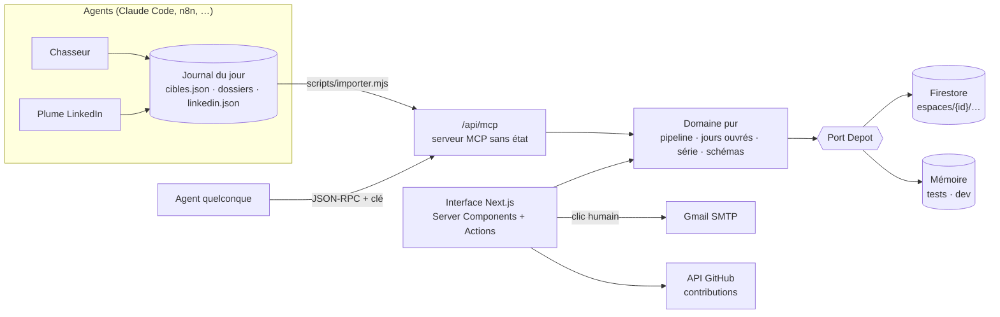

<div align="center">

# 〰️ Sillage

**Chaque jour, une trace qui avance.**

Le poste de pilotage d'une recherche d'alternance ou d'emploi : cibles sourcées, candidatures
et relances en jours ouvrés, LinkedIn trois fois par jour, agents IA branchés en **MCP**.

[](https://nextjs.org) [](https://firebase.google.com) [](https://modelcontextprotocol.io) [](#qualité) [](LICENSE)

</div>

---

## Le problème

Chercher une alternance, c'est un travail commercial : repérer les bonnes entreprises — souvent
celles qui n'ont *pas* publié d'offre —, écrire à la bonne personne, relancer au bon moment, et
rester visible. La plupart des candidats le font dans un tableur, oublient les relances, et
envoient le même CV partout.

## Ce que fait Sillage

| | |
|---|---|
| **Aujourd'hui** | Trois engagements quotidiens (candidatures envoyées, 3 posts, 1 contribution publique), la série de jours tenus, le « sillage » des 30 derniers jours, ce qui attend une action. |
| **Candidatures** | Un pipeline à transitions contrôlées (`préparée → envoyée → relancée → réponse → entretien → offre → signée`). Envoi en un clic depuis Gmail, CV joint, relances planifiées à **J+5 puis J+7 ouvrés** (fériés français calculés, Pâques compris). |
| **Cibles** | Les entreprises repérées, chacune avec un **signal sourcé** et des décideurs nommés. Recherche directe dans les **registres officiels** (Sirene/INSEE, RNE/INPI, BODACC) par secteur, département et taille, ajout en un clic, export CSV. |
| **LinkedIn** | Matin : une actu tech/IA. Midi : le projet en cours. Soir : la valeur d'une solution. Éditeur avec aperçu fidèle (pli à 210 caractères), copie, ouverture directe dans LinkedIn, suivi de publication. |
| **Journal** | Le rapport quotidien des agents : qui, pourquoi, quoi décider. |
| **Intégrations** | Un serveur **MCP** (12 outils) : Claude Code, Claude Desktop, n8n ou n'importe quel agent pilote Sillage avec les mêmes règles que l'interface. |

## Principes

1. **Rien d'inventé.** Un signal sans URL est refusé à l'entrée (schéma Zod). Un e-mail déduit est marqué « déduit ». Les CV adaptés ne réécrivent que des faits.
2. **L'humain signe.** Les agents préparent ; seul un clic humain, dans une session authentifiée, envoie un message.
3. **L'activité se constate, elle ne se déclare pas.** Le bilan du jour est *déduit* des envois horodatés, des posts publiés et du calendrier GitHub.
4. **Une seule source de règles.** L'interface et le MCP appellent le même domaine pur, testé.

## Architecture



Plus de détails : [`docs/architecture`](docs/architecture) · décisions : [`docs/adr`](docs/adr) · équipe d'agents : [`docs/equipe.md`](docs/equipe.md).

```
src/
  domaine/      types, pipeline (transitions + relances), jours ouvrés, série, schémas d'import — pur, testé
  mcp/          outils MCP + protocole JSON-RPC (écrit à la main, ~80 lignes)
  store/        port Depot + adaptateurs Firestore / mémoire, déduction de l'activité
  lib/          jetons signés HMAC, session, envoi Gmail, GitHub
  app/          accueil public, connexion par lien magique, espace privé (6 écrans), routes API
  components/   sillage (signature visuelle), anneaux, markdown restreint, apparitions
scripts/        importer.mjs — dépose le journal des agents via le MCP
```

## Démarrer

```bash
npm install
cp .env.example .env.local   # sans FIREBASE_SERVICE_ACCOUNT_B64, les données restent en mémoire
npm run dev
npm test && npm run typecheck && npm run lint
```

### Brancher un agent

```bash
claude mcp add --transport http sillage https://<votre-instance>/api/mcp \
  --header "Authorization: Bearer $SILLAGE_CLE"
```

La clé se génère dans **Intégrations**. Outils : `sillage_tableau`, `sillage_lister_cibles`,
`sillage_rechercher_entreprises`, `sillage_fiche_officielle`, `sillage_ajouter_cible`, `sillage_preparer_candidature`, `sillage_avancer_candidature`, `sillage_noter`,
`sillage_relances_dues`, `sillage_ajouter_post`, `sillage_marquer_publie`, `sillage_ecrire_rapport`.

## Qualité

- Domaine, protocole MCP, jetons, géométrie du sillage et rendu markdown couverts par Vitest.
- TypeScript strict, ESLint, accessibilité (navigation clavier, `aria-*`, `prefers-reduced-motion`), responsive dès 375 px.
- Sécurité : sessions et clés signées HMAC-SHA256 à comparaison constante, cookies `httpOnly`, données isolées par espace, réponse identique que l'e-mail de connexion soit autorisé ou non, aucun HTML brut rendu.

## Feuille de route

Voir [`ROADMAP.md`](ROADMAP.md).

---

Conçu et construit par **[Raoul Bonsso](https://github.com/RaoulBonsso)** — développeur full stack & DevOps, en recherche d'alternance à Nantes.
