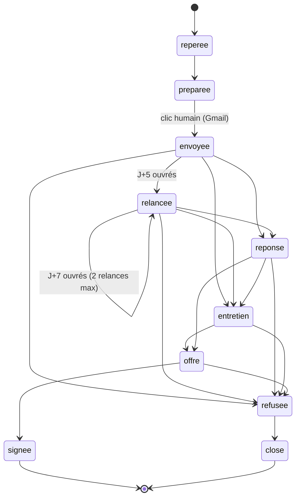

# Domaine



```mermaid
classDiagram
  class Entreprise { id; nom; ville; secteur; signal{texte, source}; score; contacts[] }
  class Contact { nom; role; email; confiance; linkedin; source }
  class Candidature { id; entrepriseId; etape; dossier; envoyeeLe; relances; prochaineRelance; historique[] }
  class Evenement { date; type; texte; auteur }
  class Post { id = date-creneau; creneau; texte; hashtags; sources; statut; publieLe; url }
  class Rapport { date; resume; auteur }
  Entreprise "1" o-- "*" Contact
  Entreprise "1" -- "0..1" Candidature
  Candidature "1" *-- "*" Evenement
```
