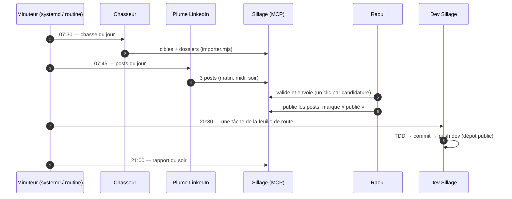

# L'équipe

Sillage est construit et exploité comme une petite entreprise : chaque rôle a un mandat, des
entrées, des sorties, et des limites. Les rôles humains et agents sont distincts — **les agents
préparent, l'humain décide et signe.**

| Rôle | Qui | Mandat | Skills / outils utilisés |
|---|---|---|---|
| **Product Owner** | Raoul (humain) | Priorise `ROADMAP.md`, valide chaque envoi, tranche les décisions signalées dans le rapport du jour. | — |
| **Architecte** | agent `architecte` | Garde le domaine pur, le port `Depot`, les ADR. Revoit toute nouvelle dépendance. | `superpowers:brainstorming`, `ecc:architecture-decision-records`, `ecc:hexagonal-architecture` |
| **Développeur** | agent `dev-sillage` ([.claude/agents](../.claude/agents/dev-sillage.md)) | Prend la première tâche non cochée de la feuille de route, la livre en TDD, commit conventionnel sur `dev`. | `superpowers:test-driven-development`, `ecc:react-testing`, `vercel:nextjs` |
| **Designer** | agent `dev-sillage` + skills design | Identité « encre, écume, balise », accessibilité, animations sobres. | `ui-ux-pro-max`, `ecc:make-interfaces-feel-better`, `ecc:motion-foundations` |
| **Chasseur** | agent `chasseur` | Repère chaque matin 8 entreprises qui ont besoin de digitalisation, avec signal et décideurs sourcés. | WebSearch, API recherche-entreprises.api.gouv.fr, Hunter.io |
| **Rédacteur de candidatures** | agent `chasseur` (même passe) | CV adapté (faits inchangés), lettre ≤ 250 mots, e-mail ≤ 120 mots, idée de mini-démo. | rendu PDF Chromium |
| **Plume LinkedIn** | agent `plume-linkedin` | 3 posts/jour : actu (matin), projet (midi), valeur (soir). Sources obligatoires. | WebSearch |
| **Relanceur** | agent `rapporteur` | Liste les relances dues, prépare le texte, signale les retards. | MCP `sillage_relances_dues` |
| **Rapporteur** | agent `rapporteur` | Rapport du soir : fait, chez qui, à décider. | MCP `sillage_ecrire_rapport` |
| **QA / Revue** | `/code-review` + `ecc:typescript-reviewer` | Revue avant merge, tests verts, build vert. | `superpowers:verification-before-completion` |
| **RSSI** | agent `securite-rssi` | Aucun secret commité, données personnelles hors dépôt, clés révocables. | `/security-review` |

## Le cycle quotidien

Les données personnelles (cibles, dossiers, posts) ne vont **jamais** dans le dépôt : elles vivent
dans le journal privé (`~/Documents/job/sillage/journal/AAAA-MM-JJ/`) puis dans Firestore.
